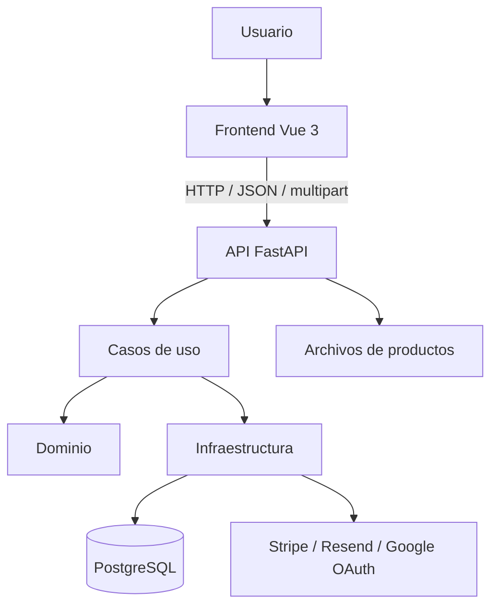

# Canasta Express

Aplicación web de comercio electrónico para una legumbrería y verdulería. El sistema permite consultar el catálogo, administrar productos, gestionar el carrito y los pedidos, realizar checkout y operar las entregas según el rol del usuario.

> **Estado de la entrega:** este README documenta la estructura y los pasos de instalación del proyecto. El equipo del proyecto preparará `create_db.sql` y los datos semilla para las pruebas manuales. Cuando esos archivos estén incorporados, se actualizarán estas instrucciones con el procedimiento exacto de ejecución. Mientras tanto, el esquema puede inicializarse mediante Alembic.

## 1. Tecnologías

| Componente | Tecnología | Versión de referencia |
| --- | --- | --- |
| Lenguaje backend | Python | 3.12 |
| Framework backend | FastAPI | 0.135.3 |
| Servidor ASGI | Uvicorn | 0.44.0 |
| Validación y configuración | Pydantic / pydantic-settings | 2.13.0 / 2.13.1 |
| ORM y migraciones | SQLAlchemy / Alembic | 2.1.4 / 1.20.0 |
| Driver PostgreSQL | asyncpg | 0.32.0 |
| Base de datos | PostgreSQL | 16 recomendado |
| Frontend | Vue | 3.5.x |
| Herramienta frontend | Vite | 6.x |
| Runtime frontend | Node.js | 20 o superior |
| Pruebas backend | pytest | 9.1.1 |

Las dependencias exactas del backend están fijadas en `backend/requirements-prod.txt` y `backend/requirements-dev.txt`. Las dependencias del frontend están declaradas en `frontend/package.json` y bloqueadas en `frontend/package-lock.json`.

## 2. Arquitectura general

El repositorio separa el frontend y el backend:

- `frontend/`: aplicación Vue 3, componentes e integración HTTP con la API.
- `backend/app/api/`: routers y contratos HTTP.
- `backend/app/application/`: casos de uso y coordinación de operaciones de aplicación.
- `backend/app/domain/`: reglas y conceptos del dominio.
- `backend/app/infrastructure/`: persistencia SQLAlchemy, configuración, servicios externos y adaptadores.
- `backend/alembic/`: migraciones versionadas del esquema de PostgreSQL.
- `backend/tests/`: pruebas automatizadas del backend.
- `backend/media/`: ubicación local de archivos multimedia durante desarrollo (configurable mediante `MEDIA_ROOT`).

Flujo simplificado:



El backend aplica autorización por rol. Las restricciones de interfaz no sustituyen la validación que realiza la API.

## 3. Requisitos previos

Instala los siguientes componentes en el equipo que ejecutará el proyecto:

- Git.
- Python 3.12.
- PostgreSQL 16 (servidor local o contenedor).
- Node.js 20 o superior y npm.
- Acceso a internet para instalar dependencias y, si se prueban, utilizar los servicios externos.

El puerto predeterminado de PostgreSQL es `5432`; el backend se ejecuta en `8000` y Vite en `5173`.

## 4. Obtener el código

```bash
git clone https://github.com/btrujillo-eng/university-project.git
cd university-project
```

Si la entrega se realiza mediante un ZIP, descomprímelo y ejecuta los siguientes pasos desde la carpeta raíz del proyecto.

## 5. Configurar PostgreSQL

Crea una base de datos PostgreSQL y prepara dos usuarios con permisos separados:

- Usuario DDL: utilizado por Alembic para crear y modificar el esquema.
- Usuario DML: utilizado por la aplicación para las operaciones ordinarias sobre los datos.

Los nombres y contraseñas deben coincidir con las variables configuradas en `backend/.env`. El usuario DDL necesita los permisos necesarios para ejecutar las migraciones; el usuario DML debe tener los permisos requeridos por la aplicación, sin privilegios administrativos innecesarios.

### Script de inicialización previsto: `create_db.sql`

El equipo del proyecto incorporará un archivo `create_db.sql` como parte de la entrega. Este script estará destinado a crear la base de datos y todas sus tablas, además de insertar los datos iniciales necesarios para las pruebas manuales.

El script incluirá cuentas de prueba para los distintos roles del sistema:

- `customer`
- `store_manager`
- `warehouse_manager`
- `packaging_manager`
- `courier`

Las contraseñas de esas cuentas se almacenarán en la base de datos únicamente como hashes compatibles con el mecanismo de autenticación de la aplicación. Para facilitar las pruebas manuales, el propio script documentará cada contraseña en texto plano mediante comentarios SQL junto al usuario correspondiente. Esas credenciales serán exclusivas del entorno de pruebas y no deben reutilizarse en producción.

**Importante:** la preparación de `create_db.sql` y de sus datos semilla queda a cargo del equipo del proyecto. Cuando el archivo se incorpore, se debe documentar aquí su comando de ejecución exacto. Hasta entonces, utiliza el procedimiento de migraciones descrito a continuación.

### Inicializar el esquema con Alembic (procedimiento disponible actualmente)

Desde la raíz del repositorio:

```bash
cd backend
```

Crea y activa un entorno virtual:

```bash
python3.12 -m venv .venv
source .venv/bin/activate
```

En Windows PowerShell:

```powershell
py -3.12 -m venv .venv
.venv\\Scripts\\Activate.ps1
```

Instala las dependencias:

```bash
python -m pip install --upgrade pip
python -m pip install -r requirements-prod.txt -r requirements-dev.txt
```

Crea el archivo de variables de entorno:

```bash
cp .env.example .env
```

En Windows PowerShell:

```powershell
Copy-Item .env.example .env
```

Edita `.env` con los datos reales del entorno local. Después ejecuta las migraciones:

```bash
alembic upgrade head
```

Las migraciones crean y actualizan el esquema. No ejecutes este procedimiento sobre una base de datos que contenga información importante sin realizar antes un respaldo.

## 6. Variables de entorno

La plantilla se encuentra en `backend/.env.example`. Configura, como mínimo:

| Variable | Propósito |
| --- | --- |
| `DDL_DB_USER` | Usuario PostgreSQL para migraciones |
| `DDL_USER_PASSWORD` | Contraseña del usuario DDL |
| `DML_DB_USER` | Usuario PostgreSQL de la aplicación |
| `DML_USER_PASSWORD` | Contraseña del usuario DML |
| `DB_HOST` | Host de PostgreSQL |
| `DB_PORT` | Puerto PostgreSQL, normalmente `5432` |
| `DB_NAME` | Nombre de la base de datos |
| `JWT_SECRET_KEY` | Secreto privado para firmar los JWT |
| `JWT_ALGORITHM` | Algoritmo de firma configurado |
| `ACCESS_TOKEN_EXPIRE_MINUTES` | Duración del token de acceso |
| `STRIPE_API_KEY` | Clave secreta de Stripe para pruebas |
| `RESEND_API_KEY` | Clave de Resend para correos |
| `GOOGLE_CLIENT_ID` | Client ID OAuth usado por el backend |

El frontend dispone de su propia plantilla en `frontend/.env.example`:

- `VITE_API_BASE_URL`: base de la API.
- `VITE_BACKEND_TARGET`: destino del proxy de desarrollo de Vite.
- `VITE_GOOGLE_CLIENT_ID`: Client ID de Google Identity Services.
- `VITE_STRIPE_PUBLISHABLE_KEY`: clave publicable de Stripe, si se habilita el pago con tarjeta.

No publiques archivos `.env`, claves privadas, contraseñas ni tokens. Los valores de `.env.example` son marcadores de posición, no credenciales funcionales. Para Google, el Client ID del frontend debe corresponder al configurado en el backend. Para Stripe, utiliza claves de prueba.

## 7. Ejecutar el backend

Desde `backend/`, con el entorno virtual activo y PostgreSQL disponible:

```bash
uvicorn main:app --reload --host 127.0.0.1 --port 8000
```

La API estará disponible en:

- API: http://127.0.0.1:8000
- Documentación Swagger: http://127.0.0.1:8000/docs
- Documentación ReDoc: http://127.0.0.1:8000/redoc

## 8. Ejecutar el frontend

Abre otra terminal desde la raíz del repositorio:

```bash
cd frontend
npm install
```

Crea el archivo de entorno:

```bash
cp .env.example .env
```

En Windows PowerShell:

```powershell
Copy-Item .env.example .env
```

Revisa las variables de `frontend/.env` y arranca Vite:

```bash
npm run dev
```

Abre http://localhost:5173.

Para comprobar la compilación de producción:

```bash
npm run build
npm run preview
```

El proxy configurado en Vite se utiliza únicamente durante el desarrollo. En un despliegue, configura `VITE_API_BASE_URL` con la dirección pública de la API y permite el origen del frontend en la configuración CORS del backend.

## 9. Roles y usuarios de prueba

El backend reconoce los siguientes roles:

| Rol | Responsabilidad principal |
| --- | --- |
| `customer` | Consultar catálogo, gestionar su carrito, realizar compras y consultar sus pedidos |
| `store_manager` | Administrar productos y precios, y asignar domiciliarios |
| `warehouse_manager` | Actualizar las existencias de productos |
| `packaging_manager` | Consultar pedidos pendientes y confirmar el empaque |
| `courier` | Consultar pedidos asignados y actualizar su estado de entrega |

El equipo del proyecto incorporará usuarios semilla para probar cada rol. En `create_db.sql`, las contraseñas se almacenarán como hashes compatibles con el mecanismo de autenticación del sistema. Para facilitar las pruebas manuales, las contraseñas correspondientes también se documentarán en texto plano mediante comentarios SQL junto a cada cuenta.

Las credenciales de prueba definitivas serán las que documente el equipo en `create_db.sql`. Hasta que se incorpore el script, no se deben asumir credenciales semilla: el registro público crea usuarios con el rol `customer`. No asignes roles privilegiados desde el frontend.

## 10. Funcionalidades y endpoints principales

| Funcionalidad | Método y ruta |
| --- | --- |
| Registro | `POST /register/user/` |
| Inicio de sesión | `POST /users/v1/auth/token` |
| Inicio de sesión con Google | `POST /users/v1/auth/google` |
| Solicitar código de recuperación | `POST /users/v1/auth/password/restore-code` |
| Verificar código | `POST /users/v1/auth/password/verify` |
| Restablecer contraseña | `POST /users/v1/auth/password/reset` |
| Consultar catálogo | `GET /products/` |
| Crear producto | `POST /products/` |
| Actualizar precio | `PATCH /products/{product_id}/price` |
| Actualizar existencias | `PATCH /products/{product_id}/stock` |
| Consultar carrito | `GET /cart/` |
| Agregar producto al carrito | `POST /cart/items` |
| Quitar producto del carrito | `DELETE /cart/items/{product_id}` |
| Checkout | `POST /orders/checkout` |

La recuperación de contraseña utiliza un código de seis dígitos con vigencia de 10 minutos. El inicio de sesión con Google requiere que el frontend obtenga un ID token mediante Google Identity Services; el backend valida su firma, audiencia y correo verificado antes de emitir el JWT propio. Las cuentas nuevas creadas mediante Google reciben el rol `customer`.

El checkout requiere el header `Idempotency-Key`, valida las existencias y el pedido mínimo actual de COP 20.000. Reutiliza la misma clave únicamente al reintentar la misma operación lógica tras un timeout o error de red. Un nuevo intento de compra debe utilizar una clave nueva. El endpoint genérico público `/payments/` fue retirado: el checkout del pedido es el punto de entrada para procesar el pago.

Las cantidades admiten hasta tres decimales para productos vendidos por peso; los productos vendidos por unidad solo aceptan cantidades enteras. Los descuentos no se aceptan desde el cliente: mientras no exista una regla de elegibilidad validada en el servidor, se aplica `no_aplica`.

## 11. Imágenes de productos

La creación de productos utiliza `multipart/form-data` y requiere los campos `name`, `section_id`, `price`, `stock`, `unit_of_measure` y el archivo `image`. Se aceptan JPEG, PNG y WebP de hasta 5 MiB. El backend genera un nombre aleatorio, guarda el archivo en `MEDIA_ROOT/products` y persiste la ruta pública en `Product.image_path`.

Por defecto, `MEDIA_ROOT=media`. En desarrollo, los archivos se sirven desde `/media`. En Docker, monta un volumen persistente en la ruta configurada como `MEDIA_ROOT`; realiza copias de seguridad de ese volumen y compártelo entre las réplicas que necesiten servir las imágenes.

Ejemplo de montaje:

```yaml
services:
  api:
    environment:
      MEDIA_ROOT: /app/media
    volumes:
      - product_media:/app/media

volumes:
  product_media:
```

## 12. Pruebas y verificación

Desde `backend/`:

```bash
python -m compileall -q app tests main.py
python -m pytest -q
```

GitHub Actions ejecuta validaciones automatizadas, incluida la compilación/importación de la API, migraciones sobre PostgreSQL temporal y pruebas.

Para ejecutar la prueba de rendimiento de autenticación contra un entorno desechable:

```bash
python scripts/performance_auth.py --base-url http://127.0.0.1:8000 --users 60 --runs 3
```

Este script crea cuentas persistentes; no lo ejecutes contra una base con datos que deban conservarse.

### Verificación para testing cruzado

Antes de entregar, el equipo que recibe el proyecto debe poder comprobar:

- [ ] Clonar o descomprimir el proyecto e instalar las dependencias.
- [ ] Configurar PostgreSQL y las variables de entorno usando las plantillas.
- [ ] Crear el esquema mediante el mecanismo documentado.
- [ ] Iniciar backend y frontend sin errores.
- [ ] Iniciar sesión con cuentas de prueba de los diferentes roles.
- [ ] Ejecutar los flujos funcionales y contrastarlos con los criterios de aceptación del Excel.
- [ ] Ejecutar las pruebas automatizadas.

Cada requisito funcional y no funcional debe tener un criterio de aceptación verificable y un método de comprobación documentado en el formato Excel de requisitos.

## 13. Entregables académicos

La entrega final del proyecto debe reunir:

1. **Formato Excel completo:** hojas Proyecto, Interesados, Requisitos funcionales, Requisitos no funcionales, Historias de usuario, Casos de uso y Mockups, actualizadas y coherentes con lo implementado.
2. **Programa implementado:** código fuente del repositorio o ZIP, este README con instrucciones de instalación y ejecución, y usuarios de prueba. Si se realiza un despliegue, se añadirá aquí la URL pública.
3. **Arquitectura y ambiente:** diagrama de componentes y capas, tecnologías y versiones, dependencias, variables de entorno y script SQL de creación de base de datos y datos de prueba (`create_db.sql`).

**URL de despliegue:** no se ha definido una URL pública para esta revisión. La aplicación se ejecuta localmente siguiendo los pasos anteriores.

## 14. Consideraciones de seguridad y limitaciones

- Nunca envíes al backend el número completo de tarjeta ni el CVV. El flujo de tarjeta debe utilizar Stripe.js/Elements en el navegador y enviar un `payment_method_id`; la clave secreta de Stripe permanece exclusivamente en el backend.
- Las claves y cuentas de Stripe/Resend utilizadas para pruebas no deben ser credenciales de producción.
- Stripe y PostgreSQL no comparten una transacción distribuida. Aunque la idempotencia evita duplicar un PaymentIntent para la misma clave, antes de producción se requiere un procedimiento operativo de reconciliación de pagos que no hayan quedado asociados a un pedido.
- Las credenciales en texto plano que se documenten como comentarios dentro de `create_db.sql` son únicamente para las cuentas semilla locales de testing. Nunca se deben utilizar en un entorno real.
- Las migraciones Alembic son el mecanismo versionado para evolucionar el esquema. El futuro `create_db.sql` debe mantenerse coherente con esas migraciones para evitar diferencias entre instalaciones nuevas y bases existentes.
